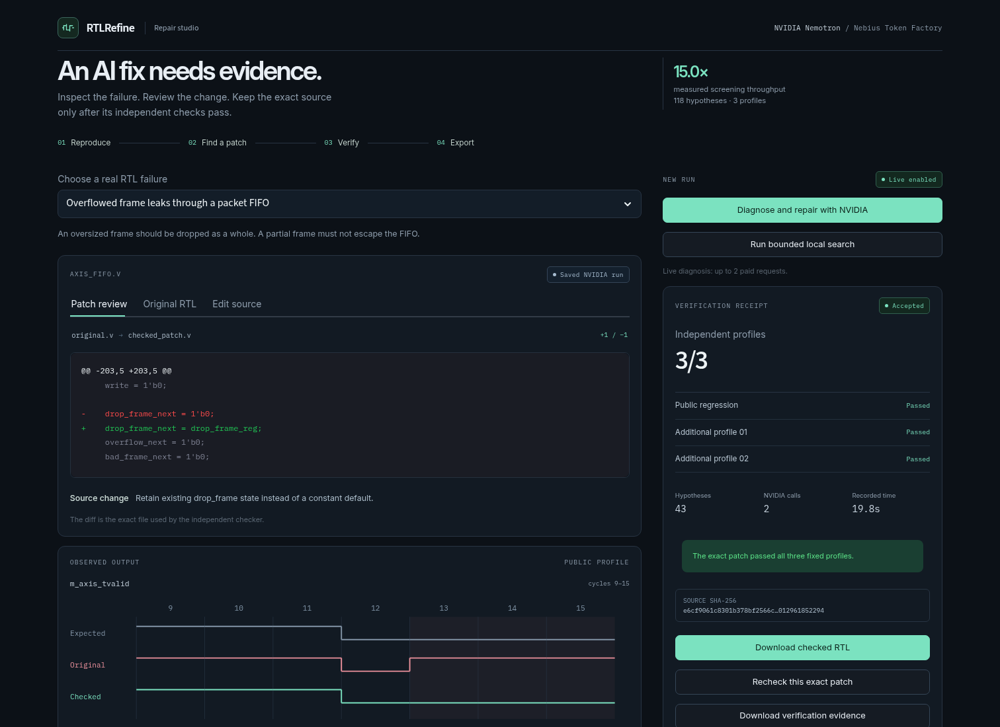

# RTLRefine

**Repair RTL, independently check the patch, and keep executable regressions with the project.**

**Independent FIFO checks are available at `/properties`.** A passing smoke
test can still hide a simultaneous-transfer, wrap or reset defect. The new mode
finds a symbolic counterexample from a fixed external-port contract, reproduces
it in Icarus against a Python queue, and gives NVIDIA that public failure.
Selected source must pass final tests, deeper bounded checks, reachable progress
and an actual standalone regression run before export. Checked ZIPs include
self-checking benches and a standard-library Python runner. Reintroducing the
bug makes the exported suite fail again, without an API key or this application.
See [the supported contract](docs/PROPERTY_REPAIR.md) and
[portable regression workflow](docs/PORTABLE_REGRESSIONS.md).

[Run the judging test build](docs/JUDGE_QUICKSTART.md) ·
[Earlier project demo](https://youtu.be/JEvktXDIUd0) ·
[Functional and external walkthrough](submission/external-v1/video/RTLRefine-external-validation-demo.mp4) ·
[Current submission materials](submission/external-v1/README.md)

**Real external RTL validation is available at `/external-validation`.** One
known upstream verilog-axis early-ready throughput regression was reproduced,
repaired by an actual NVIDIA request and rechecked across eight profiles. A
second author's unmodified ZipCPU skid buffer passes eight compatibility
profiles. Original source, licenses, pinned revisions and finite-test limits are
retained. See [external results](docs/EXTERNAL_RTL_VALIDATION.md).

**User project mode is available at `/project`.** Upload Verilog/SystemVerilog
sources and their own self-checking testbenches, with a manifest or the web file-role
wizard. Multiple files, functions, parameters, wide signals and testbench-driven
clocks are supported within the installed simulator's subset. NVIDIA proposes
design-only multi-file edits; original tests are protected and additional audit
benches are withheld until final selection. See [user project setup](docs/USER_PROJECTS.md).

NVIDIA Nemotron on Nebius diagnoses a failure and prioritizes source-generated
repair hypotheses. A shared-compilation engine screens a family of patches
without rebuilding each candidate. The selected original-format RTL is then
compiled independently and checked before it can be downloaded as accepted.

The homepage presents one workflow: inspect failing source, run repair, compare
captured outputs, inspect the diff, recheck and export the exact file. Three
supported examples cover historical packet-FIFO overflow, frame-length counting
and frame-FIFO reset defects. Earlier research tools remain in the archive.

Those three are convenience examples. The user-project route has no built-in
module-name whitelist and uses the submitted benches instead of their fixed
trace contracts. Its verification scope is exactly those provided tests.



The workspace puts the patch and captured signal comparison beside its
verification receipt. Model hypotheses, raw sample values and detailed logs can
be expanded separately. Typography is bundled locally; no remote font request
is needed. The layout also supports narrow screens.

## Measured candidate-screening throughput

Same complete pools, same public traces, fresh build directories:

| Historical profile | Candidates | Separate builds | Shared compilation | Ratio |
|---|---:|---:|---:|---:|
| Frame length | 28 | 52.43 s | 4.35 s | 12.1× |
| Packet FIFO | 43 | 66.50 s | 4.76 s | 14.0× |
| Wrapped asynchronous FIFO | 47 | 89.14 s | 4.76 s | 18.7× |
| **Total** | **118** | **208.08 s** | **13.87 s** | **15.0×** |

Every screening result matched the independently compiled result. Shared-path
cost includes the inactive-selector output control and compatibility fallbacks.
This is one paired measurement per case on this host, with ordinary filesystem
caches. It measures complete-pool screening throughput, not end-to-end repair
speed, general RTL performance, model superiority or first-in-literature novelty.

The featured recorded agent run used two actual NVIDIA requests: an initial
hypothesis and a revision using public check results. It returned an accepted
patch in 19.8 seconds. Three other curated fast-path examples each used one
request and took approximately ten seconds. These are development demonstrations;
earlier failed responses and wrong hypotheses remain available.

## Run the complete test build

```bash
docker compose up --build
```

Open http://127.0.0.1:8501. The image includes Yosys, Icarus, g++, make and
checksum-pinned Verilator 4.038. It can perform real native checks. The supplied
compose options permit nested isolation. A read-only container using tmpfs needs
executable result storage: `--tmpfs /app/results:rw,exec,mode=1777,size=256m`.

Saved provider runs need no key. New model requests are disabled by default.
Owners can enable them with `RTLREFINE_ENABLE_LIVE_MODEL=1` and a server-side
`NEBIUS_API_KEY`. Persist budget state across restarts. When reusing this
development account, retain its existing `.state/spend.json`. A repair uses at
most two bounded requests under the persistent $50 total / $20 development guard.
Keys never enter native-tool environments, downloads or images.

Native development uses `environment.yml`, `requirements-ui.lock`, and
`python3 scripts/install_verilator_pinned.py`, then:

```bash
python3 -m streamlit run rtl_app.py
```

## Example-workspace verification

Edit within the displayed module's fixed ports, parameters, clock and contract.
Candidates come from a finite source grammar. The agent can use public candidate
checks but cannot see private audit results before selection. The selected exact
uninstrumented source must pass all three profiles. Audit failure is terminal.
Changing source hides an older success immediately. Even a source that already
passes the public profile still has to pass the additional profiles.

The historical research-adapted cases use fixed-configuration native two-state
simulation and valid-qualified golden traces. Frame-length expectations also
have an independent Python byte-count guard. These checks do not establish
arbitrary-RTL, CDC/metastability or unbounded correctness. Public code may have
appeared in model training. Source licenses and artifact attribution are retained.

## Evidence

- [Current studio, protocol and limits](docs/REPAIR_STUDIO.md)
- [Actual model runs and timing records](demo/repair_studio)
- [Third-party source notices](THIRD_PARTY_NOTICES.md)
- [Deployment](docs/DEPLOYMENT.md)
- [Comparison runner for later algorithm research](docs/COMPARISON_LAB.md)
- [Earlier project README and result interpretations](README.research.md)

Earlier source/data seals and negative studies remain unchanged. This repository
publishes the reproducible source and local Docker test build. The demonstration
video is [on YouTube](https://youtu.be/JEvktXDIUd0). A separately hosted application
has not been provided; localhost addresses are local setup instructions.
